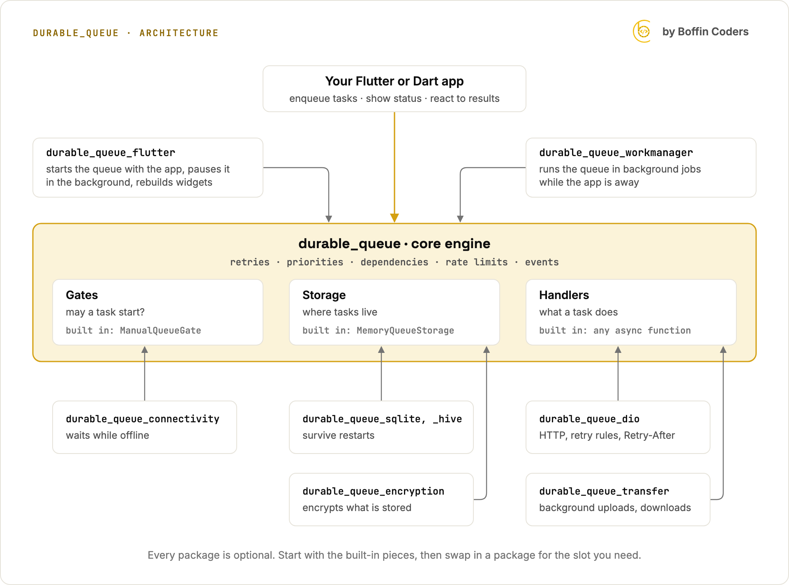

# durable_queue

[](https://pub.dev/packages/durable_queue)
[](https://github.com/boffincoders/durable_queue/actions/workflows/ci.yml)
[](LICENSE)
[](https://boffincoders.github.io/durable_queue/)

**Persistent, retryable task execution for Dart and Flutter.**

Work such as uploads, messages, and sync is described as data, stored through a pluggable storage interface, and run by a worker that owns retries with backoff, concurrency and rate limits, priorities, dependencies, deduplication, waiting for the network, and crash recovery.


Full videos on real phones: [iPhone](https://github.com/boffincoders/durable_queue/blob/main/docs/media/durable_queue_demo.mp4) (78 s) · [Android](https://github.com/boffincoders/durable_queue/blob/main/docs/media/durable_queue_demo_android.mp4) (103 s). Photos are queued, the app goes to the home screen, and every upload still reaches the server, including ones whose first try the server failed on purpose.

**[▶ Watch the 10-minute explainer](https://youtu.be/6L7gFN60PmY)** on YouTube · **[Documentation site](https://boffincoders.github.io/durable_queue/)**: the guide, every package, the cookbook, guarantees, and benchmarks in one place.

## Packages

| Package | Description | Version |
|---|---|---|
| [`durable_queue`](packages/durable_queue) | Core engine. Pure Dart, no runtime dependencies. | [](https://pub.dev/packages/durable_queue) |
| [`durable_queue_sqlite`](packages/durable_queue_sqlite) | SQLite storage: tasks survive restarts and crashes. | [](https://pub.dev/packages/durable_queue_sqlite) |
| [`durable_queue_hive`](packages/durable_queue_hive) | Hive storage (`hive_ce`) for apps that already use Hive: tasks survive restarts and crashes, on mobile, desktop, and web. | [](https://pub.dev/packages/durable_queue_hive) |
| [`durable_queue_encryption`](packages/durable_queue_encryption) | Encryption at rest: wraps any storage and encrypts task payloads and error messages with AES-256-GCM. | [](https://pub.dev/packages/durable_queue_encryption) |
| [`durable_queue_dio`](packages/durable_queue_dio) | Dio integration: HTTP retry rules, `Retry-After`, idempotency keys, cancellation, queued requests. | [](https://pub.dev/packages/durable_queue_dio) |
| [`durable_queue_flutter`](packages/durable_queue_flutter) | Flutter integration: start the queue with the app, pause it in the background, and rebuild widgets from stored tasks. | [](https://pub.dev/packages/durable_queue_flutter) |
| [`durable_queue_connectivity`](packages/durable_queue_connectivity) | Network gate for Flutter: tasks wait while offline and start when connectivity returns, with an optional reachability check. | [](https://pub.dev/packages/durable_queue_connectivity) |
| [`durable_queue_transfer`](packages/durable_queue_transfer) | Uploads and downloads that keep going after the app is minimised or closed: the operating system runs them through `background_downloader`, the queue keeps retries and dependencies. | [](https://pub.dev/packages/durable_queue_transfer) |
| [`durable_queue_workmanager`](packages/durable_queue_workmanager) | Background jobs: run the queue from Workmanager on Android and iOS while the app is away, with a lease that keeps the app and the job from running it at once. | [](https://pub.dev/packages/durable_queue_workmanager) |

Each integration is a separate package, so the core never forces a database, an HTTP client, or Flutter on you.

## How the packages fit together

The core engine decides *when* each task runs. Everything else plugs into one of three slots: a **gate** decides whether a task may start now, **storage** decides where tasks live, and a **handler** does the actual work. `durable_queue_flutter` connects the queue to your app's lifecycle and UI, and `durable_queue_workmanager` runs it in background jobs while the app is away.

<picture>
  <source media="(prefers-color-scheme: dark)" srcset="docs/media/architecture-dark.png">
  
</picture>

<details>
<summary>Text version of the diagram</summary>

```text
                    Your Flutter or Dart app
         enqueue tasks · show status · react to results
                               │
  durable_queue_flutter ──────▶│  starts the queue with the app,
  (optional)                   │  pauses it in the background,
                               │  rebuilds widgets from tasks
                               │
  durable_queue_workmanager ──▶│  runs it in background jobs
  (optional)                   │  while the app is away
                               ▼
 ┌─────────────────────────────────────────────────────────────┐
 │                 durable_queue · core engine                 │
 │  retries · priorities · dependencies · rate limits · events │
 ├───────────────────┬───────────────────┬─────────────────────┤
 │ Gates             │ Storage           │ Handlers            │
 │ may a task start? │ where tasks live  │ what a task does    │
 └─────────▲─────────┴─────────▲─────────┴──────────▲──────────┘
           │                   │                    │
           │                   │                    │
 durable_queue_        durable_queue_      durable_queue_dio
 connectivity          sqlite, _hive       HTTP requests, retry
 waits while offline   survive restarts    rules, Retry-After

                       durable_queue_      durable_queue_transfer
                       encryption          uploads, downloads the
                       encrypts what is    OS finishes in the
                       stored              background

 built in:             built in:           built in:
 ManualQueueGate       MemoryQueueStorage  any async function
```

</details>

Every package is optional. Start with the core and its built-in pieces, then swap in a package for the slot you need: SQLite or Hive when tasks must survive restarts, encryption when tasks hold personal data, the connectivity gate when work needs the network, Dio for HTTP, transfers for uploads and downloads that must finish after the app is closed. Your own gates, storage adapters, and handlers fit the same slots.

## See it work

[`examples/durable_queue_demo`](examples/durable_queue_demo) is a photo outbox app: add photos, close the app, and every photo is still uploaded and announced to the server exactly once. In CI the same app is killed in the middle of its uploads on an Android emulator and an iOS simulator, and the test checks that result ([device tests](.github/workflows/device-tests.yml)).

## Guarantees and recipes

* [What durable_queue guarantees](docs/guarantees.md): what is promised, what is not, and how it is tested, including the device kill tests.
* [Cookbook](docs/cookbook.md): offline forms, ordered chat messages, upload then notify, rate-limited sync, background jobs, progress in the UI, failed work, and testing. Every recipe is a file that CI compiles.
* [Benchmarks](docs/benchmarks.md): what storing, running, and recovering tasks costs with each storage, measured on GitHub's runners, with the method.
* [Security policy](SECURITY.md): how to report a vulnerability privately, and what is stored in plain text.

## Get started

```yaml
dependencies:
  durable_queue: ^0.5.7
```

The [documentation site](https://boffincoders.github.io/durable_queue/) and the [`durable_queue` README](packages/durable_queue/README.md) have the quick start, an architecture diagram, examples, and the full feature guide. Adapter authors should read the [storage contract](packages/durable_queue/STORAGE.md).

## Repository layout

```text
packages/
  durable_queue/                core engine (published to pub.dev)
  durable_queue_connectivity/   network gate, Flutter (published to pub.dev; outside the workspace)
  durable_queue_flutter/        Flutter integration (published to pub.dev; outside the workspace)
  durable_queue_transfer/       background uploads and downloads (published to pub.dev; outside the workspace)
  durable_queue_workmanager/    Workmanager background jobs (published to pub.dev; outside the workspace)
  durable_queue_dio/            Dio integration (published to pub.dev)
  durable_queue_encryption/     encryption at rest (published to pub.dev)
  durable_queue_hive/           Hive storage (published to pub.dev)
  durable_queue_sqlite/         SQLite storage (published to pub.dev)
  durable_queue_test_support/   shared test helpers (not published)
benchmark/                      benchmarks behind docs/benchmarks.md
docs/                           guarantees, cookbook, benchmarks, and media
examples/
  cookbook/                     the cookbook's recipes, checked by CI (not published)
  durable_queue_demo/           demo app and kill tests (not published)
website/                        the documentation site (built by website/build.dart)
pubspec.yaml                    Dart pub workspace root (not published)
CONTRIBUTING.md                 how to contribute
```

## Contributing and feedback

* Questions and ideas: [GitHub Discussions](https://github.com/boffincoders/durable_queue/discussions)
* Bugs: [issues](https://github.com/boffincoders/durable_queue/issues)
* Code and adapters: [CONTRIBUTING.md](CONTRIBUTING.md)

Licensed under the [MIT license](LICENSE).

---

<p>
  <a href="https://boffincoders.com/?utm_source=github&utm_medium=readme&utm_campaign=durable_queue"></a>
  Built and maintained by <a href="https://boffincoders.com/?utm_source=github&utm_medium=readme&utm_campaign=durable_queue">Boffin Coders</a>.<br>
  More open source: <a href="https://boffincoders.github.io/fundamental-analysis/">fundamental-analysis</a> · <a href="https://boffincoders.github.io/akamai-netstorageapi-typescript/">ts-netstorageapi-akamai</a> · <a href="https://boffincoders.github.io/">All Boffin Coders open source</a>
</p>
